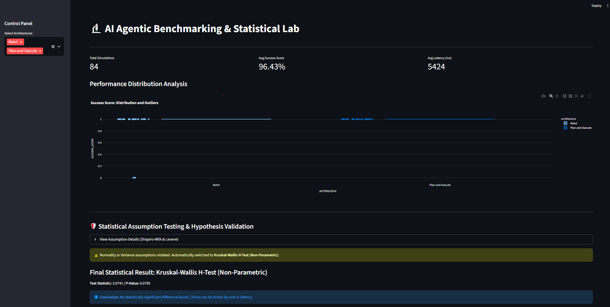
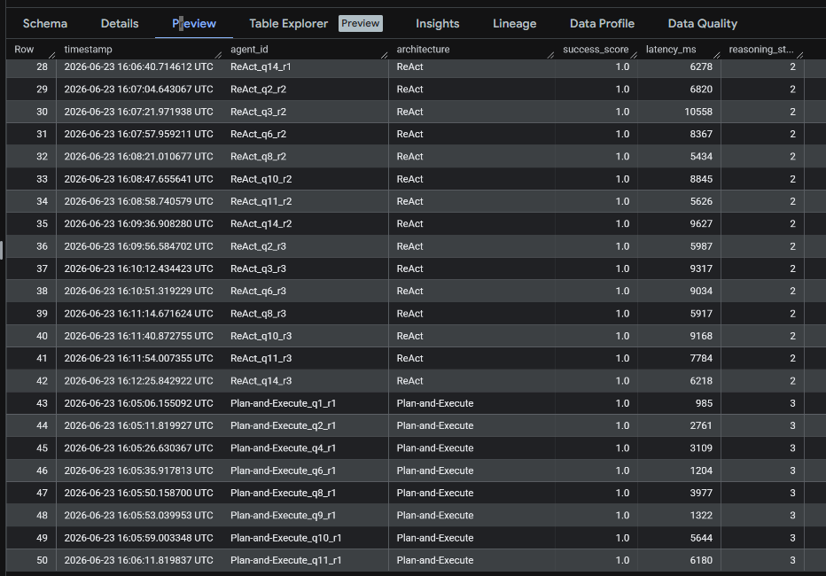

# AI Agent Benchmarking & Statistical Lab

Benchmarks two LLM agent architectures on the same finance questions and tests statistically whether one is really better, instead of comparing averages.

- **ReAct agent:** a LangChain tool-calling agent that decides step by step which tool to call.
- **Plan-and-Execute style agent:** a LangGraph state machine with fixed steps: fetch data → analyze risk → (human review if high risk) → write the report.

Both agents use the same two Yahoo Finance tools (stock price, company fundamentals) and were run with real API calls on Groq. Every run is logged to Google BigQuery, and a Streamlit dashboard runs the statistical tests on the logged data.

---

## Results (84 real runs, June 23, 2026)


*The dashboard on the 84 logged runs.*

| Metric | Value |
| --- | --- |
| Runs | 84 (14 questions × 3 repetitions × 2 architectures) |
| Successful runs | 81/84 (96.4%) |
| Success by architecture | ReAct 39/42 · LangGraph 42/42 |
| Levene (equal variances) | p = 0.08 (same as Kruskal-Wallis: with 0/1 scores both tests compare the failure counts) |
| Normality (ReAct, Shapiro-Wilk) | p < 0.001 → violated |
| Test used | Kruskal-Wallis H-test (non-parametric, chosen automatically) |
| Result | H = 3.07, p = 0.08 → no significant difference |

**Conclusion:** both architectures picked the right tools almost always, and the difference was not statistically significant. So the choice between them should be based on latency and cost, not on success rate.

**How success is measured:** a run counts as successful if the agent called every tool the question needs (for example, both tools for "full analysis"). This is checked automatically against the expected tools for each question. It measures tool selection, not the quality of the final answer.

---

## How it works

```
test_cases.py (14 questions + expected tools)
        │
        ▼
ingestion.py ──> react_agent.run()      ──┐
             └─> langgraph_agent.run()  ──┤  success, latency, reasoning steps
                                          ▼
                              Google BigQuery (one row per run)
                                          │
                          analyzer.py / app.py (Streamlit)
                  Shapiro-Wilk + Levene → ANOVA or Kruskal-Wallis
```

- **`src/agents/test_cases.py`:** the 14 finance questions (prices, fundamentals, comparisons, a Turkish ticker) and the tools each one should trigger. The same set as the evaluation in [langgraph-finance-agent-langsmith](https://github.com/Mervecaliskann/langgraph-finance-agent-langsmith).
- **`src/agents/react_agent.py`:** the ReAct agent. It returns the tools it called and the number of reasoning steps.
- **`src/agents/langgraph_agent.py`:** the LangGraph agent with a risk-based branch (P/E > 30 or daily change > 3% → human review step).
- **`src/ingestion.py`:** runs both agents on every question 3 times, measures success and latency, and uploads the rows to BigQuery. If Groq's daily token limit is reached, it stops and keeps only the real runs collected so far; it does not create placeholder rows.
- **`src/analyzer.py`** and **`app.py`:** read the runs from BigQuery, check the assumptions (Shapiro-Wilk for normality, Levene for equal variances), and then run ANOVA if they hold or Kruskal-Wallis if not.


*The 84 runs stored in BigQuery.*

---

## What I learned and limits

- **Groq's free tier limits the sample size.** About 1,100 tokens per run and a daily token budget allowed about 89 runs per day, so I used 3 repetitions per question (84 runs).
- **Success is binary (0 or 1),** so a normality test is expected to fail. A test made for proportions (a chi-square or Fisher's exact test on success counts) would be the more natural choice; Kruskal-Wallis gives a similar answer here.
- **"Plan-and-Execute" here means a fixed LangGraph workflow,** not an agent that writes its own plan first.
- **The model used for these runs (`llama-3.3-70b-versatile`) has since been retired by Groq.** To run the code again, change the model name in `src/agents/` to a current Groq model (for example `openai/gpt-oss-120b`); the results would need to be collected again.
- 14 questions is a small test set; more varied questions would make the comparison stronger.

---

## How to run

1. Install dependencies: `pip install -r requirements.txt`
2. Create a `.env` file with `GROQ_API_KEY=...`
3. Put a Google Cloud service account key in `credentials.json` (it is git-ignored and must never be committed) and create the BigQuery dataset `agent_benchmark_lab`.
4. Collect runs from the project root: `python src/ingestion.py`
5. Analyze: `python src/analyzer.py` or open the dashboard with `streamlit run app.py`

## Tech stack

Python · LangChain · LangGraph · Groq · yfinance · Google BigQuery · pandas · SciPy · Streamlit · Plotly
